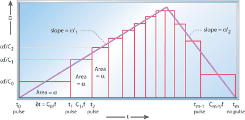

# Conceptos clave

**Entregable de la etapa 0.** Cada concepto se explica **con palabras propias**, no copiando la
fuente: si no se puede explicar sin el texto al lado, todavía no se entendió. Donde ayude, un
ejemplo con números o un dibujo. Al final de cada uno, de dónde se sacó.

Las preguntas debajo de cada título son una guía de qué tiene que quedar respondido; se borran
cuando la sección está escrita.

## 1. Pasos por milímetro

> pasos/mm = (pasos por vuelta × microstepping) / paso del husillo en mm

Un paso (principalmente conocido como step) es la unidad minima de movimiento rotacional de un motor paso a paso (en un motor paso a paso comun, por ejemplo, un paso equivale a 1.8°). Para dar un paso, se requiere de un pulso, que en este contexto, es una señal digital de corta duracion que da un salto de 0V a 5V y regresa a 0V.

Un microstepping es una tecnica que permite obtener movimientos rotacionales por debajo del paso o step. este puede llegar a ser de 1/4, 1/8, 1/16, 1/32, 1/64, etc. Por ejemplo, un microstepping de 1/4 requiere de 4 pulsos para dar un paso completo. Esta tecnica permite obtener un movimiento mucho mas suave y mayor resolucion en el posicionamiento. sin embargo, esto tambien hace que se requiera mas torque para superar la incercia del motor y el microcontrolador deberá ser capaz de entregar tales pulsos a una frecuencia mucho mayor.

El husillo es el elemento fundamental que convierte el movimiento rotacional del motor en un desplazamiento lineal sobre el equipamiento. El paso del husillo es la distancia que recorre el eje cuando el motor da una vuelta completa. Por ejemplo, si el husillo tiene un paso de 5 mm y el motor da media vuelta, el eje se desplazara 2.5 mm.

## 2. Lazo abierto

Que el control sea de lazo abierto quiere decir que no existe ninguna realimentacion, o en otras palabras, no se realiza ningun tipo de control sobre la salida. De esta forma, si el motor pierde pasos no existe ningun mecanismo que le avise al sistema de control que se ha producido un error en la salida y por ende, no podra corregirlo.

Cuando se utiliza un servomotor con un encoder, el sistema de control conoce la posicion real del motor a traves del encoder, que es un sensor que mide o detecta la posicion del motor y envia esta informacion al microcontrolador. esto hace que el sistema sepa si el motor, al compararlo con el valor de referencia, ha perdido pasos y pueda corregirlo. En este caso, el control deja de ser de lazo abierto y pasa a ser de lazo cerrado.

## 3. Rampas de aceleración

El control del sistema se realiza a traves de las rampas de aceleracion ya que se pretende manejar el torque del motor. Para lograr esto, se manipula el intervalo entre pulsos para realizar los pasos correspondientes segun el proceso a desarrollar. sin embargo, este control debe realizarse de forma controlada por las siguientes razones:

- el torque del motor decae cuando sube la velocidad debido a la inductancia de las bobinas: la corriente que pasa a traves de las bobinas no llegan a su valor maximo apenas aumenta la velocidad ya que la corriente sigue la curva exponencial indicada por la constante de tiempo tau. por lo tanto, existe una demora entre el instante que aumenta la corriente y el campo magnetico que se establece en el estator. si este cambio es muy rapido, el torque jamas llegara a su valor final y por ende, el torque se vera reducido permamentemente

- La presencia de la fuerza contraelectromotriz: un aumento en la velocidad provoca un aumento de la fuerza contraelectromotriz, que se opone al movimiento del rotor, reduciendo el torque.

- un tren de pulsos que se traduzca en un cambio abrupto de velocidad haria que el motor se pierda pasos: para lograr el movimiento, primero se debe vencer al torque de inercia. un cambio brusco en la velocidad no permitiria que se desarrolle el torque necesario para vencer esa inercia, provocando que el motor se detenga y se pierdan pasos. esto se mitiga parcialmente con un sistema de control de lazo cerrado, ya que el sistema seria capaz de detectar ese error y corregirlo. sin embargo, esto hace que se tenga que enviar varios pulsos mas, que se traduce en mas corriente y, si no se tiene cuidado, en mayores corrientes nominales de trabajo.

Austin describe que para obtener una rampa de aceleracion adecuada en tiempo real sin necesidad de resolver operaciones costosas computacionalmente, hay que reducir el tiempo entre pulsos de forma gradual. Esto se veria de la siguiente manera (para desacelerar, hay que aumentar gradualmente el tiempo entre pulsos):

Para lograr esto, se asume una aceleracion constante durante el proceso de arranque (y de parada tambien).

Matematicamente, esto se puede expresar como: $$C_n = C_{n-1} - \frac{2 \cdot C_{n-1}}{4 n+1}$$ Donde Cn es el tiempo entre pulsos actuales y Cn-1 es el tiempo entre pulsos anteriores. 

Austin advierte que, en el arranque, el primer pulso se debe calcular a partir de la siguiente ecuacion: $$C_0 = f \sqrt{\frac{2\alpha}{\omega'}}$$

Pero es bastante impreciso, por lo que se debe multiplicar por un factor de correccion.

$$C_0 = 0,676 \cdot f \cdot \sqrt{\frac{2\alpha}{\omega'}}$$

Para desacelerar, se le asigna valores negativos a la posicion $n_i=i-n$. de modo que ahora:

$$C_i = C_{i-1} + \frac{2 \cdot C_{i-1}}{4 (i-m)+1}$$

Esto ultimo se traduce en aumentar el intervalo entre pulsos, lo que provoca que el motor reduzca su velocidad de forma gradual.

## 4. Pulsos por timer

Los pulsos deben salir de una interrupcion de timer por que si salieran del loop principal, la velocidad del motor estaria sujeta a la complejidad de dicho loop principal. si en el mismo hay instrucciones con costos computacionales altos, la velocidad de salida de los pulsos dependera del procesamiento requerido en ese entonces y los pulsos de salida tendran un patron irregular. 

Cuando se trabaja con interrupciones de alta prioridad, apenas se cumple la condicion de interrupcion, el microcontrolador deja de lado lo que estaba haciendo y ejecuta el servicio de interrupcion. Al ser de alta prioridad, siempre se va a ejecutar sin importar que es lo que este haciendo. de esta forma el ritmo de salida de los pulsos seran constantes. 

## 5. Coordinación de ejes

Para lograr que dos motores lleguen juntos al final de una diagonal se utiliza el algoritmo de Bresenham. 

El algoritmo de Bresenham es un metodo rapido para dibujar lineas rectas en una cuadricula de pixeles, utilizando solamente sumas y restas. Esto ultimo hace que sea ideal para ser implementado en microcontroladores, ya que no requiere de operaciones costosas computacionalmente hablando. 

Si bien este algoritmo se pensó (y de hecho, se sigue utilizado) principalmente para dibujar lineas en una pantalla con pixeles. Este mismo algoritmo se puede utilizar tambien como un metodo para sincronizar dos motores.

La idea fundamental del algoritmo de Bresenham aplicado a pasos (o pulsos de motor) consiste en traducir una ecuación matemática continua (como una línea recta o un arco) en una secuencia de decisiones discretas paso a paso, determinando a qué eje le corresponde recibir un pulso en cada ciclo de ejecución para mantener la herramienta exactamente sobre la trayectoria deseada.

En el caso del CNC el espacio el espacio no es continuo sino una rejilla física definida por los pasos fijos del motor. Es decir: Si hay que mover la máquina en diagonal desde el origen $(0,0)$ hasta la coordenada $(100, 50)$, el eje $X$ debe dar $100$ pasos y el eje $Y$ debe dar $50$ pasos. *El algoritmo no movera ambos ejes al mismo tiempo, solo uno por ciclo y dependiendo de la pendiente de la recta, se ira eligiendo cual eje mover.*

## 6. Roscado

Para tallar una rosca (un helicoide continuo sobre un cilindro), la distancia axial que avanza la herramienta de corte debe sincronizarse estrictamente con el giro de la pieza:
- Avance por vuelta ($F_{\text{rev}}$): Cada vez que el husillo da una vuelta completa ($360^\circ$), la herramienta debe desplazarse longitudinalmente una distancia exacta equivalente al paso de la rosca ($P$). En la seccion 1 se dio un ejemplo con un husillo de 5 mm. si el motor da media vuelta, el husillo debe avanzar 2.5 mm.

- Fórmula de avance lineal por minuto ($F$):
$$F \left[\frac{\text{mm}}{\text{min}}\right] = \text{RPM} \left[\frac{\text{vueltas}}{\text{min}}\right] \times \text{Paso} \left[\frac{\text{mm}}{\text{vuelta}}\right]$$

    Si la velocidad de rotación RPM cambia levemente durante la pasada (por ejemplo, si el motor del husillo pierde velocidad al entrar en corte), el avance lineal del eje debe acelerar o desacelerar proporcionalmente e instantáneamente para mantener constante el paso de la rosca.

Tallar una rosca requiere múltiples pasadas consecutivas para profundizar progresivamente la herramienta en la ranura.
Por lo que la herramienta debe entrar a la pieza exactamente en la misma "huella" o canal helicoidal que cortó en la pasada anterior.

Si no llegase a coincidir, la herramienta no entrará en el canal anterior, sino que cortará sobre la cresta existente, destruyendo la rosca previa y dejando el material completamente arruinado (mecanizado "retrasquilado").

Para garantizar esta sincronización angular y cinemática en tiempo real, el husillo del torno necesita:
- Un Encoder Óptico (o Resolver) en el Husillo: Un sensor montado en el eje principal que envía pulsos digitales al controlador. Debe contar obligatoriamente con un canal de índice o marca de cero (Index Pulse / Z-Pulse) que emite un único pulso por cada vuelta completa de $360^\circ$.
- Sincronización por Hardware/Firmware en Tiempo Real: El controlador detecta la marca de cero para iniciar el movimiento del eje $Z$ en el instante exacto y utiliza los pulsos continuos del encoder para variar la frecuencia de pulsos de los ejes según la velocidad real instantánea del husillo.

El funcionamiento de un torno CNC frente al de una fresadora CNC puede parecer muy similar debido a que se utilizan los mismos conceptos en su funcionamiento. Sin embargo, hay diferencias fundamentales:

- En una fresadora CNC, la herramienta de corte gira y la pieza se desplaza respecto de ella. En algunas configuraciones, también puede moverse el cabezal de la herramienta. el husillo (la herramienta que gira) opera como un motor independiente de velocidad continua (bucle abierto). El controlador simplemente le ordena "girar a 3000 RPM" mediante un relé o señal PWM, mientras que los ejes ($X, Y, Z$) se mueven en función de su propio reloj/temporizador interno (usando algoritmos como Austin o Bresenham para coordinar tiempo y espacio).
- En un torno CNC, la pieza de trabajo (osea, el material como tal) gira y la herramienta de corte se desplaza para retirar material. La variable maestra del tiempo ya no la dicta el temporizador interno del microcontrolador, sino la posición angular física del husillo. El controlador debe ejecutar las trayectorias de los ejes esclavizadas directamente a los impulsos del encoder del husillo.

Esa capacidad de interpolar los ejes de movimiento lineal sincronizados en tiempo real con la posición angular exacta de un husillo es el rasgo cinemático distintivo que define la lógica de control de un torno frente a una fresadora.
